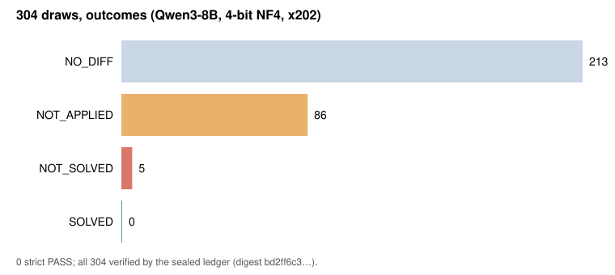

# Finding — the Pascal 4-bit series on Qwen3-8B

**Run:** `torch-8b-pascal-4bit-002` · `recorded-on` 2026-11-23 · seed `20261123` · base
`Qwen/Qwen3-8B` @ `b968826d9c46dd6066d109eabc6255188de91218` (`PREREGISTRATION.md` § 10.28–§ 10.30) ·
host `x202` (3× NVIDIA GTX 1080 8 GB, Pascal `sm_61`) · `torch 2.14.1+cu126` · **4-bit NF4 with
bf16 compute** through the declared `quantize.json` sidecar · the quantized base spread 12/12/12
over the three cards by an explicit layer range (§ 10.30).

This is the near-miss probe under § 10.28: § 10.27's sample minus the two macOS-only tasks —
**18 private near-miss tasks + the public task**, `K = 16`, **304 draws**. The probe draws; it
trains nothing.

## The result

**304/304 draws completed. Zero strict-`PASS`. The chain is proven: every control `INTACT`,
`check-probe` `PROCEED`.**

| outcome | draws | share |
|---|---:|---:|
| `NO_DIFF` | 213 | 70.1% |
| `NOT_APPLIED` | 86 | 28.3% |
| `NOT_SOLVED` | 5 | 1.6% |
| **`SOLVED`** | **0** | **0%** |

- **91 outputs (29.9%) were real diffs** — 86 were refused by `git apply`, 5 applied and failed
  their declared tests. **213 (70.1%) were prose** and produced no patch.
- **No patch passed the strict verifier**, so § 10.28's GO rule (at least one strict `PASS` in
  304 draws) is **not met**. This is a **NO-GO**.
- The ledger's denominator is **304** with **`solved: 0`, `unverified: 0`**: every draw
  completed, none was skipped, and none timed out.

## Per task

| task | `NO_DIFF` | `NOT_APPLIED` | `NOT_SOLVED` | `SOLVED` |
|---|---:|---:|---:|---:|
| `donor-a-12a1d8e4d766` | 7 | 9 | 0 | 0 |
| `donor-a-2f4e497580ff` | 12 | 1 | 3 | 0 |
| `donor-a-3326ca8a116d` | 14 | 2 | 0 | 0 |
| `donor-a-34daf85182d5` | 10 | 5 | 1 | 0 |
| `donor-a-37a91266029a` | 15 | 1 | 0 | 0 |
| `donor-a-4731e32044c5` | 8 | 8 | 0 | 0 |
| `donor-a-5e25b106874c` | 11 | 4 | 1 | 0 |
| `donor-a-6d35bb3a4d17` | 13 | 3 | 0 | 0 |
| `donor-a-955d9a079c16` | 6 | 10 | 0 | 0 |
| `donor-a-99c0e0464c21` | 15 | 1 | 0 | 0 |
| `donor-a-a93fe36d6e85` | 12 | 4 | 0 | 0 |
| `donor-a-c32d7c672465` | 13 | 3 | 0 | 0 |
| `donor-a-d601ff2d0ec0` | 13 | 3 | 0 | 0 |
| `donor-a-df207b27e82c` | 14 | 2 | 0 | 0 |
| `donor-a-f100a90e47f2` | 13 | 3 | 0 | 0 |
| `donor-b-0fe4582aeac1` | 11 | 5 | 0 | 0 |
| `donor-b-c3e132b7469b` | 7 | 9 | 0 | 0 |
| `donor-b-ce6425d3101a` | 10 | 6 | 0 | 0 |
| `pallets__flask-4045` | 9 | 7 | 0 | 0 |
| **total (19)** | **213** | **86** | **5** | **0** |

## Cost and time

- Generation: median **330.3 s**, p90 **791.6 s**, **35.1 h** total over 304 draws.
- Wall clock: ~17.5 h after the § 10.30 resume, across two days with one pause, one OOM
  (§ 10.30) and one resume that replayed the 160 draws already recorded.
- VRAM at prefill: 5.9 / 4.7 / 5.9 GB on the three cards.

## What this says, and what it does not

- On this host, at this precision, the 8B base clears the **format** wall on ~30% of near-miss
  draws and the **verifier** on none. The near-miss hypothesis is not confirmed here.
- The result is **non-comparable** to the MPS series (§ 10.20–§ 10.25) or to any bf16 CUDA figure:
  4-bit weights, a Pascal device and an 18-task sample sit between them. No figure here may be
  restated as either.
- It is not a claim about the base in bf16, and not a claim about the 51-task corpus. The two
  macOS-only tasks were excluded before the measurement (§ 10.28).
- A NO-GO returns the lever to a human, never to a loosened verifier (§ 10.28).

## Evidence

- **Ledger:** `docs/planning/pascal-4bit/evidence/ledger.json` (committed; 28 KB, SHA-256
  `63b1ac3361eb19f8812cdb8eea7d0afa5c0290185c5ea819d35fe3924d4fc30c`), content digest
  `bd2ff6c318e710593326810edfc80a9ce70ae9bbdfdf5f4ffb7fd39b723a409d`, sealed. It carries no
  code, prompt or private path — only ids, counts, digests and the backend.
- **Draws:** 16 attempt journals + transcripts, 304 rollout records, archived under
  `runs/torch-8b-pascal-4bit-002/`.
- **`check-probe`:** `PROCEED` (exit 0); `probe 18`, `runtime torch`, `device cuda`,
  `precision bfloat16`.
- **Controls:** 16/16 attempts `private PASS`, `public PASS`; no non-`INTACT` probe in 304.
- The x202 files added for the measurement are removed after this finding; the ledger and the
  draws above are the archived evidence.
